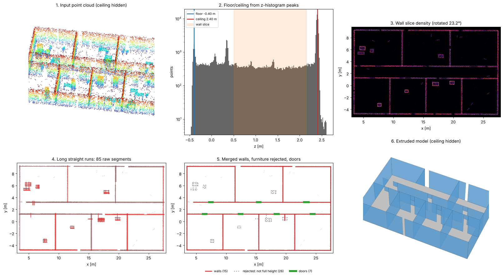
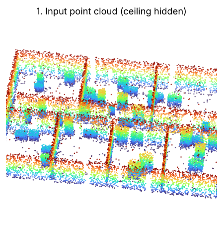
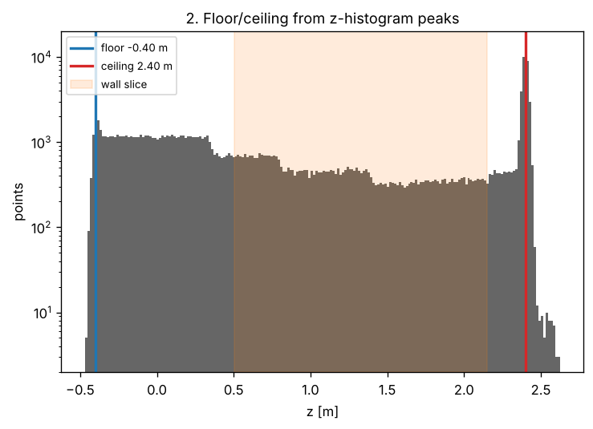
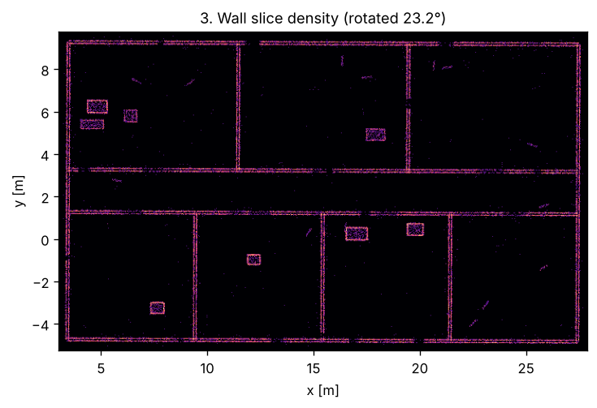
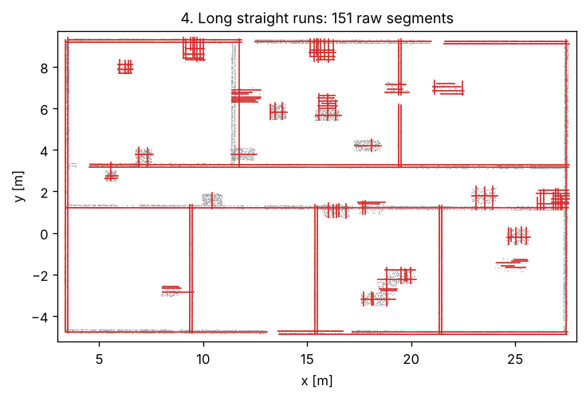
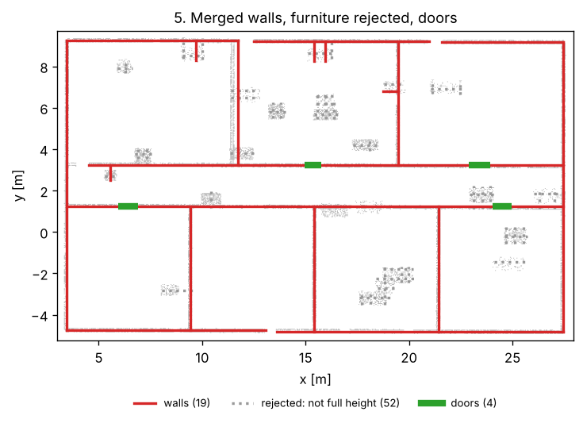
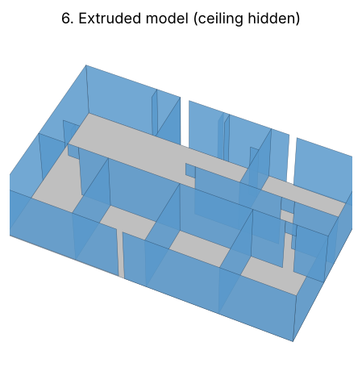
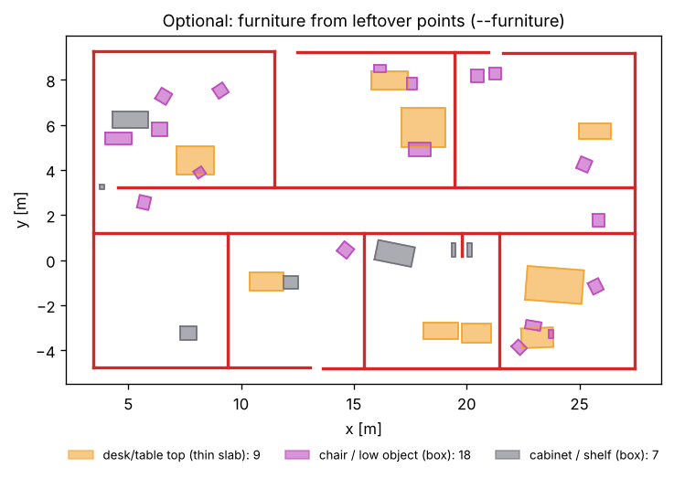
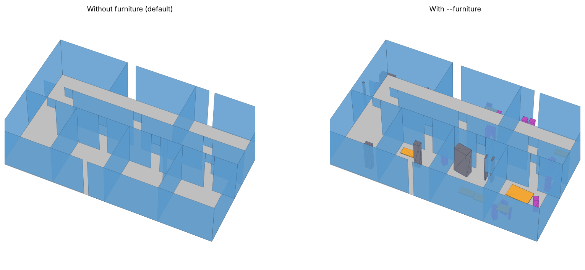
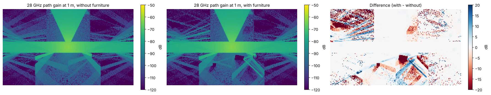

# lidar_rt

Turn a lidar point cloud of an indoor space (e.g. a [GLIM](https://github.com/koide3/glim) map) into a
clean, low-polygon **2.5D building model** — floor, ceiling, walls with door openings — that can be loaded
directly into a ray tracer such as [Sionna RT](https://nvlabs.github.io/sionna/rt/).



Instead of fitting planes in 3D with RANSAC (which tends to miss the floor and short walls, and produces
spurious slanted planes through clutter), the pipeline treats the building as a **floor plan** and then
extrudes it. All figures below come from the included synthetic office
(`python make_figures.py synthetic_office.npy docs` regenerates them).

## How it works

### 1. Input point cloud
The dense map from GLIM (or any SLAM system), gravity-aligned with z up. The cloud is voxel-downsampled
and statistical outliers are removed. The synthetic test map is deliberately rotated 23° and offset, has
sparse floor returns, desks and cabinets, ceiling clutter, occlusion holes and noise.



### 2. Floor and ceiling from the height histogram
Horizontal surfaces produce sharp peaks in the histogram of z; walls spread evenly over z. The floor is
the *lowest* strong peak in the lower half and the ceiling the *highest* strong peak in the upper half
(desk tops can outnumber a sparsely seen floor, but they are always above it). This works even when the
floor is sparsely sampled, which is where 3D RANSAC usually fails. The shaded band is the wall slice used next:
from 0.9 m above the floor (above desks) to 0.25 m below the ceiling (below lights). Including the band
above door height means the wall above a door still shows up, so walls are not broken at doorways
or behind furniture.



### 3. Manhattan alignment and 2D density image
Local 2D PCA on the slice gives a line direction at every point; a histogram of those directions folded
modulo 90° gives the building orientation. The slice is rotated so the walls are axis-aligned and
rasterized into a density image (4 cm pixels).



### 4. Long straight runs
A morphological *close* along each axis bridges small holes in a wall, then an *open* with a long, thin
kernel (≥ 0.6 m) keeps only straight runs at least that long. Each connected component becomes a raw
segment. Furniture still produces many short segments at this stage.



### 5. Merge, reject furniture, snap corners, find doors
- Parallel segments closer than 0.3 m (the two faces of one wall) are merged.
- A segment is kept only if the **full cloud** has points along it both near the floor and near the
  ceiling. Desks and cabinets fail the high test; ceiling ducts and lights fail the low test.
- Endpoints are snapped onto perpendicular walls to close corners.
- **Doors** are runs along a wall with no points at standing height (0.3–1.9 m above the floor) that are
  0.6–2.0 m wide. The top of the door is taken from the lowest points above it. Closed doors return
  points, so they stay solid. A doorway blocked by furniture is (correctly) left closed.



### 6. Extrude and export
Walls are extruded from floor to ceiling, with a section left above each door opening, and floor and
ceiling slabs are added. The model is rotated back into the **original map frame** and written as PLY
meshes plus a Sionna RT `scene.xml` with ITU radio materials (plasterboard walls, concrete floor,
ceiling board by default). The small slits visible in some walls are large full-height occlusion holes in
the synthetic data; increase `--gap` to bridge them.



### 7. Optional: simplified furniture (`--furniture`)
With `--furniture`, the points left over after removing floor, ceiling, ceiling clutter and walls are
turned into simple objects:

- **Desks / tables → thin slabs.** On a top-height map (highest point per 5 cm cell), large flat regions
  at desk height (0.55–1.1 m) whose *edges* have nothing underneath except legs become a 4 cm slab at
  the top, so rays can still pass under them. A low cabinet has side panels all around its edge and fails
  this test; a chair pushed under a desk doesn't affect it.
- **Everything else → oriented boxes.** Remaining clusters (chairs, cabinets, printers, boxes, ...) each
  get a solid box from the floor to their top, rotated to fit the cluster.
- **Materials:** desks, chairs and low objects use `--furniture-material` (default `wood`); objects
  taller than 1.4 m (filing cabinets, shelving) use `--tall-material` (default `metal`). They are
  written as separate meshes (`furniture.ply`, `furniture_tall.ply`) so materials can be changed later.



The same reconstruction without (default) and with `--furniture`:



Furniture matters most at mmWave. At 28 GHz with an access point near the ceiling in the corridor, it
casts shadows of up to about 20 dB (red) and adds some new reflection paths (blue). At sub-6 GHz the walls
dominate and furniture is usually a second-order effect.



Furniture boxes are deliberately crude, and they are only as good as what the lidar saw. Objects that move
(chairs, people walking by during mapping) leave partial or ghost clusters, so check
`floorplan_debug.png`, where desks are drawn in cyan, chairs and other objects in magenta, and tall
objects in orange.

### 8. Ray tracing
The scene loads directly in Sionna RT. A 3.5 GHz radio map with the transmitter in the corridor shows the
expected behaviour: the corridor guides the signal, it leaks into offices through the doorways, and
it drops behind each wall.


## Plans

- [Real-to-sim calibration of the path-estimation simulator](plans/real_to_sim.md): using real TX/RX robot
  measurements in a `lidar_rt` scene to calibrate a Sionna-based simulator of `est_paths()` output, without
  and with motion capture.

## Installation

```bash
pip install -r requirements.txt
```

`open3d` is only needed to read `.ply`/`.pcd`; `sionna-rt` and `matplotlib` only for `test_sionna.py`.

## Usage

### 1. Export the map from GLIM

Save the dense map as a point cloud (e.g. `.ply` / `.pcd`, via the GLIM offline viewer's export, or by
merging the submaps). GLIM maps built with an IMU are gravity-aligned (z up), which the pipeline assumes.

### 2. Build the scene

```bash
python cloud_to_floorplan.py glim_map.ply -o office_scene
```

Outputs in `office_scene/`:

| File | Contents |
|---|---|
| `scene.xml` | Sionna RT / Mitsuba scene with ITU radio materials |
| `meshes/walls.ply`, `floor.ply`, `ceiling.ply` | Meshes, in the **same frame as the input map** |
| `meshes/furniture.ply`, `furniture_tall.ply` | Furniture boxes (only with `--furniture`) |
| `walls.csv` | Wall endpoints (x0, y0, x1, y1) in the map frame, for inspection or hand-editing |
| `floorplan_debug.png` | Density image with detected walls (red) and doors (green), in the aligned frame |

**Always look at `floorplan_debug.png` first** — it is the fastest way to tune parameters.

Because the model stays in the map frame, robot trajectory poses from GLIM can be used directly as
transmitter/receiver positions.

### 3. Ray trace

```python
from sionna.rt import load_scene, Transmitter, Receiver, PlanarArray, PathSolver
scene = load_scene("office_scene/scene.xml")
scene.frequency = 3.5e9
scene.tx_array = scene.rx_array = PlanarArray(num_rows=1, num_cols=1, pattern="iso", polarization="V")
scene.add(Transmitter("tx", position=[x_tx, y_tx, z_tx]))
scene.add(Receiver("rx", position=[x_rx, y_rx, z_rx]))
paths = PathSolver()(scene, max_depth=4, refraction=True)
```

See `test_sionna.py` for a complete example including a radio map.

## Parameters

| Option | Default | Meaning |
|---|---|---|
| `--voxel` | 0.03 | Downsampling voxel size [m] |
| `--res` | 0.04 | Floor-plan pixel size [m] |
| `--floor`, `--ceiling` | auto | Override floor / ceiling z if the histogram picks wrong peaks |
| `--slice LO HI` | 0.9 -0.25 | Wall slice: `LO` m above floor to `HI` m relative to ceiling |
| `--min-hits` | 2 | Points per pixel for a pixel to count as occupied (raise for dense maps) |
| `--min-len` | 0.6 | Shortest wall kept [m] |
| `--gap` | 0.5 | Bridge holes in a wall up to this length [m] |
| `--merge-sep` | 0.30 | Merge parallel faces closer than this into one wall [m] |
| `--snap` | 0.5 | Corner snapping tolerance [m] |
| `--no-doors` | off | Don't carve door openings |
| `--keep-partial` | off | Keep segments that don't reach floor and ceiling (cubicle partitions, etc.) |
| `--wall-thickness` | 0 | 0 = thin quads (thickness only in the material); >0 = box walls [m] |
| `--furniture` | off | Add simplified desks (slabs), chairs/objects and cabinets (boxes) |
| `--furniture-material` | wood | Material for desks, chairs, low objects |
| `--tall-material` | metal | Material for objects taller than 1.4 m |
| `--wall-material` | plasterboard | Sionna ITU material for walls (`concrete`, `brick`, `glass`, `wood`, ...) |
| `--wall-material-thickness` | 0.12 | Material thickness used for transmission [m] |

## Testing without data

```bash
python make_synthetic_office.py                     # writes synthetic_office.npy
python cloud_to_floorplan.py synthetic_office.npy -o test_scene
python test_sionna.py test_scene/scene.xml          # traces paths, writes radio_map_test.png
python cloud_to_floorplan.py synthetic_office.npy -o test_scene_f --furniture   # with furniture
python make_figures.py synthetic_office.npy docs    # regenerates the figures in this README
```

The synthetic office has 11 walls with 7 doorways, 14 desks (top + legs), 14 chairs (seat + back, random
orientation), 8 cabinets, ceiling clutter, sparse floor returns, occlusion holes, noise, and an arbitrary
yaw/offset. All walls and all 7 doors are recovered. With `--furniture`, all 8 cabinets are found, and
the 14 desks come out as 9 slabs because desks that overlap in the random placement merge into one.

## Limitations and tips

- **Manhattan assumption.** Walls are assumed to be at right angles. For diagonal walls, replace
  `extract_segments()` with `cv2.HoughLinesP` / LSD on the occupancy image and skip corner snapping.
- **Glass.** Lidar mostly passes through glass, so glass partitions and windows are usually missing.
  Add them by hand (edit `walls.csv` / add a separate PLY with `glass` material in `scene.xml`).
- **Single storey, flat ceiling.** One floor and one ceiling height are used for the whole map.
  Crop multi-storey maps first; for varying ceiling heights, override per region.
- **Floor/ceiling are rectangles** covering the wall extents. Fine for ray tracing inside the building;
  replace with the true footprint polygon if the building is strongly non-convex and you trace outside it.
- **Materials.** Everything is one wall material by default. Splitting walls by material (concrete
  exterior vs. drywall interior, glass, metal) usually matters more for RF accuracy than small
  geometry errors.
- **Furniture.** Off by default; `--furniture` adds simple boxes and slabs. For more detail, a decimated
  mesh of the leftover points (e.g. Poisson or TSDF reconstruction) can be added as an extra object.
- **Validate** against a few channel measurements (path loss / PDP) before trusting the model.
