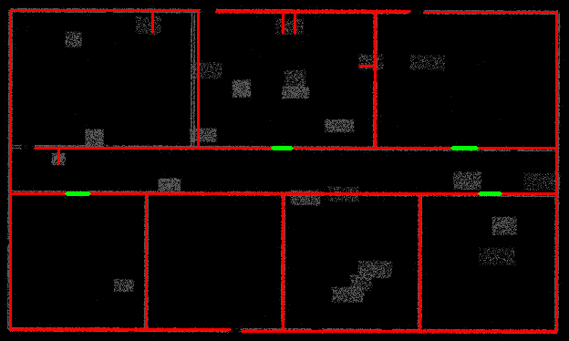
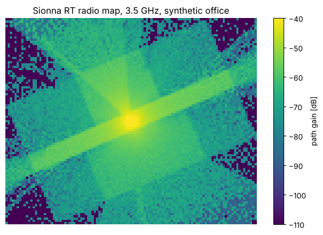

# lidar_rt

Turn a lidar point cloud of an indoor space (e.g. a [GLIM](https://github.com/koide3/glim) map) into a
clean, low-polygon **2.5D building model** — floor, ceiling, walls with door openings — that can be loaded
directly into a ray tracer such as [Sionna RT](https://nvlabs.github.io/sionna/rt/).

Instead of fitting planes in 3D with RANSAC (which tends to miss the floor and short walls, and produces
spurious slanted planes through clutter), the pipeline treats the building as a floor plan:

1. Clean the cloud (voxel downsample, statistical outlier removal).
2. Find **floor and ceiling heights** from peaks in the z-histogram.
3. Find the **dominant wall direction** (Manhattan alignment) from 2D local PCA in a wall slice.
4. Project a horizontal slice (0.9 m above floor → just below ceiling) onto a 2D density image.
   Including the band above door height lets lintels bridge doorways and walls occluded by furniture.
5. Extract **straight wall segments** with morphological line filtering (long thin opening kernels).
6. Merge the two faces of each wall, bridge small gaps, **reject partial-height structures**
   (desks, cabinets, ducts must reach both floor *and* ceiling to count as walls), snap corners.
7. Detect **door openings**: runs along a wall with no points at standing height. Closed doors return
   points, so they stay solid.
8. Extrude walls floor→ceiling (lintels above doors), add floor/ceiling slabs, rotate back to the
   original map frame, and export PLY meshes plus a Sionna RT `scene.xml` with ITU radio materials.

| Extracted floor plan (red = walls, green = doors) | Sionna RT radio map, 3.5 GHz |
|---|---|
|  |  |

*(Both images are from the included synthetic office test.)*

## Installation

```bash
pip install -r requirements.txt
```

`open3d` is only needed to read `.ply`/`.pcd`; `sionna-rt` and `matplotlib` only for `test_sionna.py`.

## Usage

### 1. Export the map from GLIM

Save the dense map as a point cloud (e.g. `.ply` / `.pcd`, via the GLIM offline viewer's export, or by
merging the submaps). GLIM maps built with an IMU are gravity-aligned (z up), which the pipeline assumes.

### 2. Build the scene

```bash
python cloud_to_floorplan.py glim_map.ply -o office_scene
```

Outputs in `office_scene/`:

| File | Contents |
|---|---|
| `scene.xml` | Sionna RT / Mitsuba scene with ITU radio materials |
| `meshes/walls.ply`, `floor.ply`, `ceiling.ply` | Meshes, in the **same frame as the input map** |
| `walls.csv` | Wall endpoints (x0, y0, x1, y1) in the map frame, for inspection or hand-editing |
| `floorplan_debug.png` | Density image with detected walls (red) and doors (green), in the aligned frame |

**Always look at `floorplan_debug.png` first** — it is the fastest way to tune parameters.

Because the model stays in the map frame, robot trajectory poses from GLIM can be used directly as
transmitter/receiver positions.

### 3. Ray trace

```python
from sionna.rt import load_scene, Transmitter, Receiver, PlanarArray, PathSolver
scene = load_scene("office_scene/scene.xml")
scene.frequency = 3.5e9
scene.tx_array = scene.rx_array = PlanarArray(num_rows=1, num_cols=1, pattern="iso", polarization="V")
scene.add(Transmitter("tx", position=[x_tx, y_tx, z_tx]))
scene.add(Receiver("rx", position=[x_rx, y_rx, z_rx]))
paths = PathSolver()(scene, max_depth=4, refraction=True)
```

See `test_sionna.py` for a complete example including a radio map.

## Parameters

| Option | Default | Meaning |
|---|---|---|
| `--voxel` | 0.03 | Downsampling voxel size [m] |
| `--res` | 0.04 | Floor-plan pixel size [m] |
| `--floor`, `--ceiling` | auto | Override floor / ceiling z if the histogram picks wrong peaks |
| `--slice LO HI` | 0.9 -0.25 | Wall slice: `LO` m above floor to `HI` m relative to ceiling |
| `--min-hits` | 2 | Points per pixel for a pixel to count as occupied (raise for dense maps) |
| `--min-len` | 0.6 | Shortest wall kept [m] |
| `--gap` | 0.5 | Bridge holes in a wall up to this length [m] |
| `--merge-sep` | 0.30 | Merge parallel faces closer than this into one wall [m] |
| `--snap` | 0.5 | Corner snapping tolerance [m] |
| `--no-doors` | off | Don't carve door openings |
| `--keep-partial` | off | Keep segments that don't reach floor and ceiling (cubicle partitions, etc.) |
| `--wall-thickness` | 0 | 0 = thin quads (thickness only in the material); >0 = box walls [m] |
| `--wall-material` | plasterboard | Sionna ITU material for walls (`concrete`, `brick`, `glass`, `wood`, ...) |
| `--wall-material-thickness` | 0.12 | Material thickness used for transmission [m] |

## Testing without data

```bash
python make_synthetic_office.py                     # writes synthetic_office.npy
python cloud_to_floorplan.py synthetic_office.npy -o test_scene
python test_sionna.py test_scene/scene.xml          # traces paths, writes radio_map_test.png
```

The synthetic office has 11 walls with 7 doorways, desks and cabinets, ceiling clutter, sparse floor
returns, occlusion holes, noise, and an arbitrary yaw/offset. All walls are recovered; doorways blocked
by furniture in the synthetic data are (correctly) left closed.

## Limitations and tips

- **Manhattan assumption.** Walls are assumed to be at right angles. For diagonal walls, replace
  `extract_segments()` with `cv2.HoughLinesP` / LSD on the occupancy image and skip corner snapping.
- **Glass.** Lidar mostly passes through glass, so glass partitions and windows are usually missing.
  Add them by hand (edit `walls.csv` / add a separate PLY with `glass` material in `scene.xml`).
- **Single storey, flat ceiling.** One floor and one ceiling height are used for the whole map.
  Crop multi-storey maps first; for varying ceiling heights, override per region.
- **Floor/ceiling are rectangles** covering the wall extents. Fine for ray tracing inside the building;
  replace with the true footprint polygon if the building is strongly non-convex and you trace outside it.
- **Materials.** Everything is one wall material by default. Splitting walls by material (concrete
  exterior vs. drywall interior, glass, metal) usually matters more for RF accuracy than small
  geometry errors.
- **Furniture.** Removed on purpose. At mmWave it can matter; a decimated mesh of the clutter (e.g.
  Poisson or TSDF reconstruction of the residual points) can be added as an extra object.
- **Validate** against a few channel measurements (path loss / PDP) before trusting the model.
