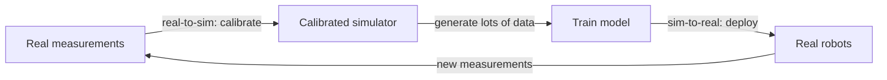
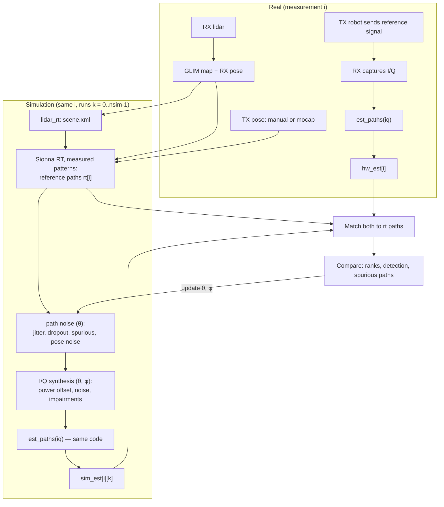
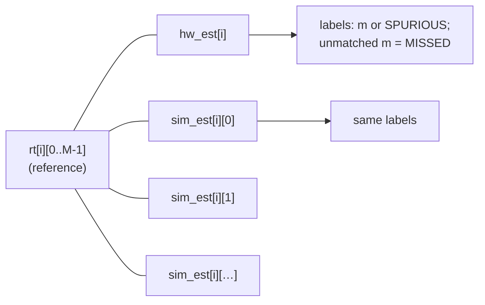
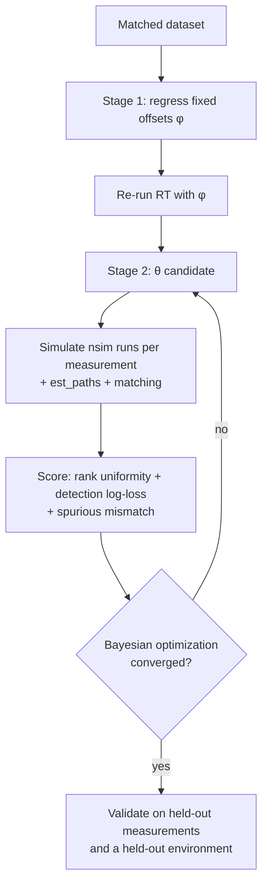
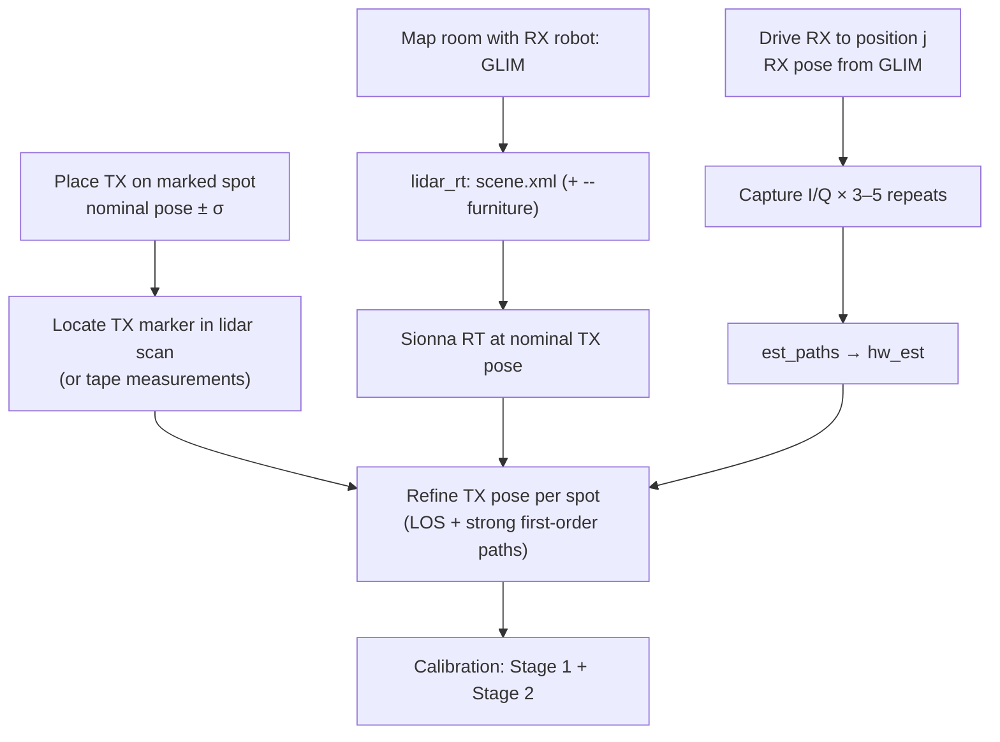
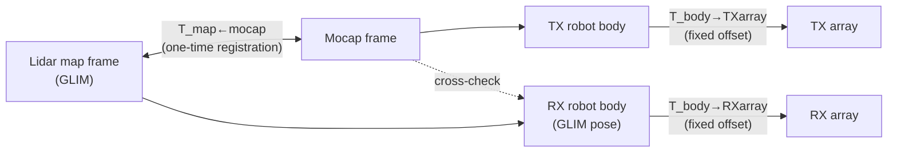
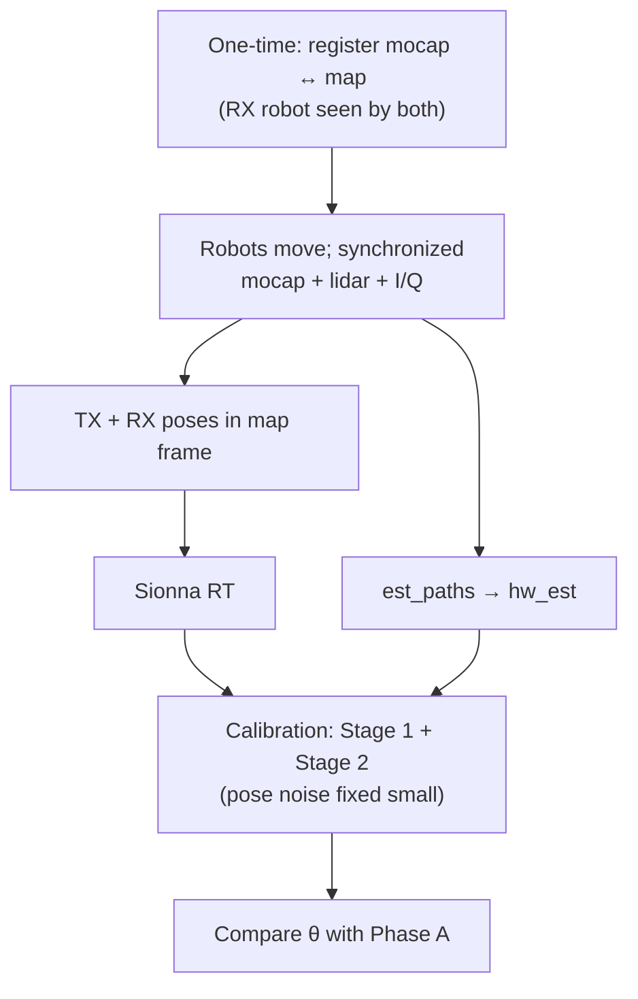

# Real-to-sim calibration of the path-estimation simulator

## Sim-to-real vs. real-to-sim

- **Sim-to-real** is the overall goal: train in simulation, because it is fast, and deploy on the real
  TX/RX robots.
- **Real-to-sim** is what this plan covers: use real measurements to *calibrate the simulator*, so that
  simulated path estimates are statistically indistinguishable from real ones. It is the step that
  makes sim-to-real work.

## 1. Setup and notation

**Real pipeline (one measurement `i`)**

1. The TX sends a periodic reference signal; the RX records I/Q.
2. `hw_est[i] = est_paths(iq)` → a list of paths `(aoa_az, aoa_el, dly, snr)`. Delays are relative,
   since there is no absolute timing.
3. The RX runs the lidar; GLIM gives the 3D map and the RX pose in the map frame.
4. The TX pose is placed in the same frame: manually (Phase A) or from motion capture (Phase B).

**Simulation pipeline (same measurement `i`)**

1. `lidar_rt` turns the map into a Sionna scene.
2. Sionna RT, with the measured antenna patterns and array geometry, gives the **noise-free reference
   paths** `rt[i][m]`, plus metadata per path: order (LOS, first, second reflection, ...) and which
   objects it interacts with (from `Paths.interactions` / `Paths.objects`).
3. The paths are perturbed with **path noise**: jitter, dropout, spurious paths, pose noise.
4. I/Q is synthesized with **sample noise**: power offset, thermal noise, hardware impairments.
5. The **same** `est_paths()` runs on the simulated I/Q → `sim_est[i][k]` for runs `k = 0..nsim-1`.

### Parameters

The unknowns are split into two groups, fitted in this order:

| Group | Symbol | Contents | How it is fitted |
|---|---|---|---|
| Fixed offsets | φ | TX power / noise-figure offset; RX lidar→array offset; pose biases (per robot or registration); material corrections per surface class | Direct regression on matched paths (Stage 1) |
| Random noise | θ | AoA / delay / power jitter **by path order**; dropout probability (as a function of order and gain); spurious-path rate and distribution; diffuse scattering on/off and strength; I/Q impairments; random pose noise | Distribution matching (Stage 2) |

Errors that are shared across measurements (e.g. a wrong wall material) must **not** be redrawn on every
simulation run. They are either fitted as fixed offsets in φ, or drawn once per environment and held
fixed across all `i`.

## 2. Path matching

Both `hw_est[i]` and every `sim_est[i][k]` are matched to the **reference paths `rt[i]`**, never to
each other. This gives every estimate a consistent label `m` across all runs.

Algorithm, for one estimate list against `rt[i]`:

1. **Delay alignment.** Estimated delays are relative. Search a common shift `δ` that best aligns the
   estimated delays with `rt[i]` (a 1-D search, or anchor on the strongest path), so a missed first
   path does not shift everything.
2. **Cost.** `C[n, m] = (angle(aoa_n, aoa_m) / σ_a)² + ((dly_n − δ − τ_m) / σ_τ)²`, plus an optional
   power term. Use the angle on the sphere, not the difference in azimuth.
3. **Gating.** Pairs with `C > c_max` are disallowed (e.g. 3σ).
4. **Assignment.** Hungarian algorithm (`scipy.optimize.linear_sum_assignment`).
5. **Output.** `matched[m] = n or None` (None = missed); unmatched `n` are spurious.

Output per measurement: a table with one row per reference path `m` (fields: hw value or MISSED, `nsim`
sim values or MISSED, path order, objects hit), plus spurious-path lists for hardware and sim.

## 3. Calibration

### Stage 1: fixed offsets (φ)

On matched hardware ↔ reference pairs:

| Offset | Estimate from |
|---|---|
| Power / noise-figure constant | Linear fit of `hw SNR` against `rt path gain (dB)`; the intercept is the offset. The scatter is RT power error (goes to θ). |
| RX array mounting rotation | Mean AoA error of LOS paths (in the array frame) over all measurements |
| TX pose bias | LOS AoA + relative delay errors, grouped by TX placement (Phase A) or mocap registration (Phase B) |
| Material corrections | Mean power residual grouped by **surface class** hit (walls, glass, floor, furniture, ...). Optionally: fit materials with Sionna's differentiable RT instead. |

Re-run ray tracing with φ applied before Stage 2.

### Stage 2: random noise (θ)

There is **one hardware sample per (i, m)**, so the test is not "does `hw_est[i][m]` have the same
distribution as `sim_est[i][:][m]`". It is "does each hardware value look like one more draw from its
simulated distribution", pooled over all (i, m):

1. **Rank test (PIT).** For each matched (i, m) and each of AoA, delay and SNR: `r = rank of hw value among
   the nsim sim values / nsim`. With the right θ, `r` is uniform on [0, 1].
   - U-shaped histogram → simulated noise too small
   - Peaked in the middle → simulated noise too large
   - Tilted → bias, which goes back to Stage 1
2. **Detection.** `p[i][m]` = fraction of sim runs that detect path m. Score against whether the hardware
   detected it: log-loss, and a reliability plot (predicted vs. observed detection rate).
3. **Spurious paths.** Compare the number of spurious paths per measurement (hw) with its sim
   distribution, plus their SNR and delay distributions.
4. **Global check.** Two-sample test (MMD or classifier) on the pooled joint distribution of
   `(number of paths, aoa, dly, snr)`. This is not used for fitting, only as a final check.

`est_paths` is not differentiable, so θ is fitted with a black-box optimizer (Bayesian optimization,
e.g. Optuna or BoTorch), with a coarse grid first to get sensible ranges. θ should have **few parameters**
(roughly 10–20), split by path order (LOS / first order / second order and higher), otherwise it will
overfit.

### Measuring sample noise directly

Repeat each real measurement several times **without moving anything**. The spread across repeats is
pure measurement + estimator noise. Its distribution fixes the I/Q noise part of θ before Stage 2, so
Stage 2 only has to fit the ray-tracing and pose errors. This separates the two causes that otherwise
look alike (low SNR and RT error both cause angle errors and missed paths).

## 4. Phase A: without motion capture (manual TX placement)

Without motion capture, the TX pose is the weakest link. Several degrees of TX orientation error map
directly into AoD/AoA errors and wrong reflection geometry, so the plan treats the TX pose as **uncertain
and partly estimated**.

### Data collection

1. **Map the room** with the RX robot (GLIM) and build the scene with `lidar_rt`. Keep the room static
   during the session: no people, and furniture that does not move.
2. **TX placement on surveyed spots.** Mark 5–10 floor positions with tape. For each, record the position
   in the map frame by one of:
   - (preferred) placing a **lidar-visible marker** on the TX robot (a tall box or pole) and locating it in
     a GLIM scan: it appears as a cluster at a known height;
   - measuring distances to two walls (tape or laser rangefinder) and converting to map coordinates.
3. **TX orientation.** Align the TX to a wall or to tape lines on the floor; record the nominal yaw. Expect
   ±2–5° error.
4. **RX positions.** For each TX spot, drive the RX robot to many positions (LOS and NLOS); at each one,
   stop and take **3–5 repeated captures** (for the sample-noise estimate). The RX pose comes from GLIM.
5. **Log** per measurement: TX spot id, nominal TX pose, RX pose, I/Q file, `est_paths` output, radio
   settings (gain, frequency, bandwidth).

### TX pose refinement

For each TX spot (shared by all RX positions using it), refine `(x, y, yaw)` by minimizing the
mismatch between hardware and RT paths **for LOS and strong first-order paths only**, with a prior
penalty `‖pose − nominal‖² / σ_pose²`.

- It is shared over many RX positions, so it is well determined.
- It uses only paths whose geometry is reliable, so it does not soak up general ray-tracing error.
- The size of the corrections tells you σ_pose. Whatever pose error remains goes into θ as random pose
  noise.

Check: hold out some RX positions per spot. If refining the pose improves the hold-out fit for LOS only
but makes reflected paths worse, the pose is overfitting; tighten the prior.

### Expected outcome

A calibrated θ, φ, but with the TX pose uncertainty partly mixed into the angle jitter. This is the
**conservative** calibration: noise may be somewhat overestimated, which is the safe direction for
training.

## 5. Phase B: with motion capture

Motion capture removes most of the TX pose uncertainty and makes data collection continuous.

### Coordinate frames

1. **Register mocap to the map frame.** Put mocap markers on the **RX robot** too. Its pose is then
   known in both frames (GLIM and mocap). Drive it around and solve for the rigid transform
   `T_map←mocap` from the paired trajectories (Umeyama / Kabsch, or hand-eye calibration if
   orientation is used). Residual errors over the trajectory tell you how good GLIM localization is.
2. **Time sync.** Timestamp mocap, lidar and I/Q captures on a common clock (PTP/NTP, or a shared
   trigger). Robots in motion with 50 ms of skew move several cm.
3. **Robot→array offsets.** Measure from CAD or a fixture, then refine the yaw/offset using the LOS
   AoA bias (same as Stage 1, now with an accurate TX pose).

### Data collection

- Both robots can move; capture continuously or stop-and-go. Stop-and-go with repeats is still needed
  for the sample-noise estimate.
- Many more TX poses (positions *and* orientations), which is the main gain over Phase A.
- Same static-environment rules: people in the room add paths that are not in the map. Optionally
  record their presence (mocap sees them) and exclude those captures.

### Changes to the calibration

- No per-spot TX pose refinement; the TX pose comes from mocap (σ ≈ mm, < 1°).
- The random pose noise in θ is now small and can be fixed from the mocap/GLIM registration residuals.
- Stage 2 then measures the **ray-tracing error itself**, separated from pose error. Compare θ from
  Phase A and Phase B: the difference in angle jitter is roughly the pose contribution in Phase A.

## 6. Validation: does sim-to-real actually work?

Matching distributions is a means. The real tests:

1. **Held-out measurements.** Ranks, detection and spurious scores on data not used in fitting.
2. **Held-out environment.** Calibrate in room 1 and validate in room 2. This shows whether θ is a
   property of the hardware and ray tracer, or of one room.
3. **Downstream task.** Train the target model on (a) calibrated sim, (b) uncalibrated sim, and (c) real
   data only, and test all three on real data. Calibration is good enough when (a) approaches (c), and
   clearly beats (b).

## 7. Implementation plan

New package in this repo, `lidar_rt/calib/` (names indicative):

| Module | Purpose |
|---|---|
| `dataset.py` | Measurement record: env id, TX/RX poses (+ σ), I/Q path, `hw_est`, radio settings; load/save (Parquet or HDF5) |
| `rt_paths.py` | Sionna RT with measured patterns; reference paths with order and surfaces hit |
| `perturb.py` | Path noise: jitter by order, dropout, spurious paths, pose noise, per-environment material offsets |
| `synth_iq.py` | CIR → reference signal → I/Q with power offset, noise and impairments |
| `associate.py` | Delay alignment, gated Hungarian matching |
| `metrics.py` | Rank (PIT) histograms, detection log-loss, reliability plots, spurious stats, MMD |
| `stage1.py` | Fixed-offset regression (power, mounting, pose bias, materials) |
| `calibrate.py` | Stage 2 loop with Optuna/BoTorch |
| `tx_pose.py` | Phase A per-spot TX pose refinement |
| `mocap_reg.py` | Phase B mocap↔map registration and time alignment |

`est_paths` is your existing code, used as-is on both sides.

### Milestones

1. **Synthetic end-to-end test (no hardware).** Generate "hardware" data from the simulator itself with a
   known θ_true, then check that calibration recovers it. This validates matching, metrics and
   optimizer before any real data is involved.
2. **Phase A pilot.** One room, 3 TX spots, ~30 RX positions × 3 repeats. Check that Stage 1 offsets
   are stable and rank histograms are sensible.
3. **Phase A full.** 5–10 TX spots, a few hundred measurements, second room for hold-out.
4. **Phase B.** Mocap registration, continuous capture, compare θ with Phase A.
5. **Sim-to-real test** on the downstream task.

## 8. Open questions

- **`est_paths` output.** Does it report elevation? Is delay relative to the first detected path or to
  the strongest path? Does it report per-path phase or Doppler? Matching should use everything that is
  reported.
- **Bandwidth and frequency.** These set delay resolution and how much diffuse scattering matters (mmWave
  vs. sub-6).
- **Which errors matter for the downstream task?** If the model uses only the strongest few paths,
  calibrate those carefully and model weak paths loosely.
- **How many measurements?** Rank histograms need on the order of a few hundred matched paths per path
  order to be informative. A few hundred measurements is a reasonable first target.
- **Diffuse scattering.** Test whether enabling Sionna's diffuse scattering reduces the spurious-path
  mismatch more than adding spurious paths synthetically.
